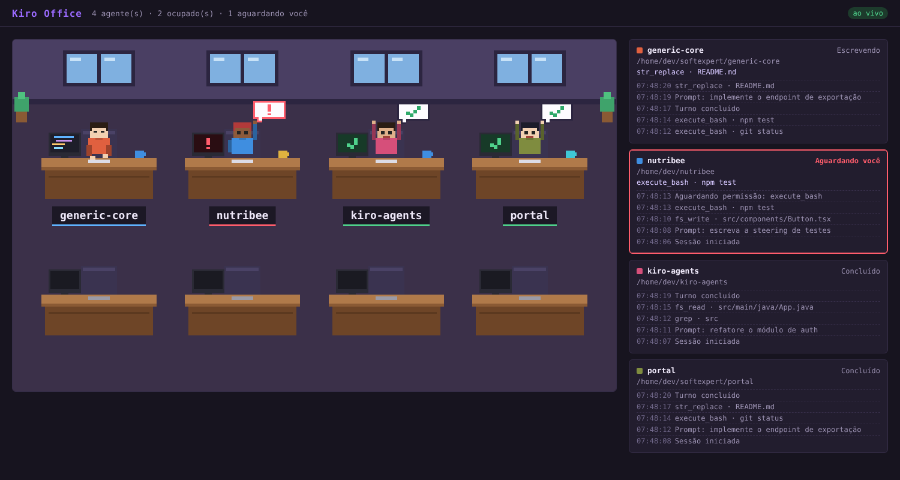

# Kiro Office

Um escritório em pixel-art, rodando localmente, onde cada sessão do **Kiro CLI** vira um fantasminha. Ele digita quando o agente escreve código, lê quando busca arquivos, mostra o terminal quando roda comandos e levanta a mãozinha com um **"!"** quando precisa da sua permissão. Quando fica ocioso, vai flutuando até o **café** tomar um cafezinho, e volta para a mesa assim que chega um novo prompt.

Inspirado no [Pixel Agents](https://github.com/pablodelucca/pixel-agents), que hoje só suporta o Claude Code. Este é um MVP próprio para o Kiro CLI, sem dependências e sem assets de terceiros: os fantasminhas e o cenário são desenhados em código.



## Como funciona

```
kiro-cli ──(hooks)──▶ hooks/send.js ──POST──▶ servidor local :4317 ──SSE──▶ navegador (canvas)
```

1. **Hooks globais** em `~/.kiro/hooks/` disparam a cada evento da sessão (início, prompt, uso de ferramenta, pedido de permissão, fim do turno, fim da sessão).
2. O **`hooks/send.js`** lê o JSON do STDIN e repassa para o servidor local. Ele **nunca escreve no STDOUT** (que iria para o contexto do agente), **sempre sai com código 0** e termina em até 1,5 s, mesmo com o servidor desligado. Não bloqueia nem altera nada no agente.
3. O **servidor** (Node puro) guarda o estado por `session_id` e transmite para o navegador via Server-Sent Events.
4. O **navegador** desenha o escritório em canvas e mostra um painel com o log de cada sessão.

| Evento do Kiro CLI | Fantasminha |
|---|---|
| `SessionStart` | entra pela porta do café e flutua até a mesa |
| `UserPromptSubmit` | pensando (balão "...") |
| `PreToolUse` | `fs_read`/`grep` → lendo · `fs_write`/`str_replace` → escrevendo · `execute_bash` → terminal · `web_*` → web · `mcp_*` → MCP · `use_subagent` → delegando |
| `PostToolUse` | volta a pensar |
| `PermissionRequest` | mão levantada + **"!"** vermelho (a aba do navegador pisca) |
| `Stop` | comemora ✓; depois de alguns segundos ocioso, vai para o café ☕ |
| `SessionEnd` | sai pela porta e some |

Os **balões de fala** mostram a ação atual: `lendo App.java`, `editando Button.tsx`, `$ npm test`, `web kiro.dev`, `mcp jira:get_issue`, `delegando → 3 sub`, `permitir? git status` (em vermelho) e `pronto! ✓`.

### Nomes

- O **rótulo abaixo da mesa** é a pasta do projeto: o último trecho do `cwd`, com `#2`, `#3` se houver mais de uma sessão na mesma pasta.
- A **plaquinha dourada na mesa** é o **agente** do Kiro (como `generic-tech-lead`). O Kiro CLI não manda esse nome nos hooks, então o servidor procura, nesta ordem:
  1. `--agent <nome>` na linha de comando do `kiro-cli` (o hook sobe a árvore de processos para achar). É a fonte mais confiável; abra com `kiro-cli chat --agent generic-tech-lead`.
  2. Um campo de agente no payload, ou uma variável de ambiente `*AGENT_NAME`.
  3. `session_state.agent_name` no arquivo de sessão (`~/.kiro/sessions/cli/`).
  4. O agente padrão, em `"chat.defaultAgent"` de `~/.kiro/settings/cli.json`.

  Se você troca de agente com `/agent` no meio da sessão, a plaquinha não acompanha. O `/api/debug` mostra de onde veio o nome (`agentSource`).

### Subagentes

No Kiro CLI, um subagente é chamado por uma ferramenta `subagent_<nome-do-agente>` (por exemplo `subagent_generic-software-engineer`) e **usa o mesmo `session_id` do pai**. Por isso o Kiro Office trata assim:

- No `PreToolUse` de `subagent_*`, nasce um **filhote** da cor do pai, com o nome do agente (vindo do nome da ferramenta). Ele sai da mesa do pai junto com um aviãozinho de papel.
- Enquanto o subagente está aberto, as ações que chegam nessa sessão são atribuídas ao filhote, não ao pai. O pai fica "Delegando", e o balão dele mostra a ação do filho (`↳ $ git status`).
- No `PostToolUse` da mesma ferramenta `subagent_*`, o filhote voa até o pai com um papel, entrega o resultado e some.
- Com **vários subagentes em paralelo** não dá para saber de qual é cada ação: os filhotes ficam "Trabalhando", as ações vão para o log do pai e pedidos de permissão aparecem no pai.
- Se o Kiro algum dia mandar subagentes com `session_id` próprio, o servidor também os vincula ao pai: por um campo de pai no payload, pelo arquivo de sessão ou por correlação com a delegação aberta.

Os agentes não conversam entre si: o pai manda a tarefa e cada subagente devolve o resultado.

### Diagnóstico

`http://127.0.0.1:4317/api/debug` mostra:
- os últimos payloads recebidos dos hooks;
- a pasta de sessões do Kiro que o servidor está usando;
- os arquivos candidatos de cada sessão;
- a estrutura (chaves) dos arquivos `.json`, `.history` e `.jsonl` mais recentes. Valores aparecem só para chaves como `agent`, `name`, `model` e `parent`.

Use quando algo não aparecer como esperado.

## Requisitos

- Node.js 20+
- Kiro CLI V3 (o `PermissionRequest` exige a versão 3.4.0 ou mais nova)

## Instalação e uso

```bash
git clone https://github.com/wribeiiro/kiro-office.git
cd kiro-office

# 1. sobe o escritório
npm start                       # http://127.0.0.1:4317

# 2. (opcional) testa sem o kiro-cli, em outro terminal
npm run demo

# 3. instala os hooks globais (~/.kiro/hooks/kiro-office-*.json)
npm run install-hooks
```

Depois abra uma **nova** sessão do `kiro-cli`, em qualquer projeto, e confira com `/hooks` se os hooks `kiro-office-*` foram carregados.

Outros comandos:

```bash
node bin/kiro-office.js status                 # lista os hooks instalados
node bin/kiro-office.js install-hooks --workspace  # instala só no projeto atual (.kiro/hooks)
npm run uninstall-hooks                        # remove os hooks
node bin/kiro-office.js start --port 5000      # outra porta (exporte KIRO_OFFICE_PORT=5000 para os hooks)
npm test
```

> Os hooks apontam para o caminho absoluto deste clone. Se mover a pasta, rode `npm run install-hooks` de novo.

## Observações do MVP

- **Nomes dos gatilhos:** `SessionStart`, `PreToolUse`, `PostToolUse`, `PermissionRequest` e `SessionEnd` estão documentados. Já `UserPromptSubmit` e `Stop` seguem os nomes da CLI 2.x em PascalCase. Cada gatilho fica num arquivo separado: se a sua versão do CLI não reconhecer algum, os outros continuam funcionando. Se `/hooks` não listar algum, me avise ou ajuste o nome em `src/hooks-installer.js`.
- O servidor só escuta em `127.0.0.1` e o estado fica só em memória.
- Uma sessão sem eventos por 15 minutos sai do escritório sozinha.
- O texto do prompt (variável `USER_PROMPT`) aparece no painel lateral. Fica só na sua máquina.

## Estrutura

```
bin/kiro-office.js        CLI (start, install-hooks, uninstall-hooks, status)
hooks/send.js             script executado pelos hooks do Kiro CLI
src/events.js             normalização de eventos e categorias de ferramentas
src/store.js              estado das sessões
src/server.js             HTTP + SSE + arquivos estáticos
src/hooks-installer.js    gera os arquivos ~/.kiro/hooks/kiro-office-*.json
public/                   página do escritório (canvas)
scripts/demo.js           simulador de sessões
test/                     testes (node --test)
```

## Licença

MIT
